# Information architecture pass (issue #175)

Source revision for the screenshots: branch `issue/175-information-architecture`
on top of main `66cb52e`, captured on 2026-10-12 from a fresh preview with two
captured tasks and no connectors beyond the bundled Baikal. Desktop captures
are 1280 px wide, scaled to half size; phone captures are 390 px wide.

## Structure

The sidebar lists the views used daily and keeps the rest in two named
groups. Every route stays reachable by URL and from the command bar, whose
Navigate group is unchanged.

| Group   | Views                                        | Behaviour                                                             |
| ------- | -------------------------------------------- | --------------------------------------------------------------------- |
| (daily) | Today, Inbox, Planner, Tasks, Boards, Habits | Always listed.                                                        |
| Records | History, Worklog, Counters, Reuse            | Collapsed by default; opens itself while one of its views is current. |
| Setup   | Connections, Settings                        | Same as Records.                                                      |

The open state of each group is remembered per browser in
`localStorage` under `tadooer.sidebar-group:<id>`. On phones the groups are
flattened into the scrolling row and the toggles are hidden, so the row reads
Today … Habits, History … Reuse, Connections, Settings.

## Audit by route

Each route was checked for its primary action and for content that should sit
behind a disclosure, a tab or a sub-route. "Done" means this pass changed it;
"later" is a recommendation for a follow-up.

| Route            | Primary action                     | Finding                                                                                                                                                                                                                                                                                     | State |
| ---------------- | ---------------------------------- | ------------------------------------------------------------------------------------------------------------------------------------------------------------------------------------------------------------------------------------------------------------------------------------------- | ----- |
| Today            | Capture, then work the queue       | Overdue and Scheduled today rendered as empty cards whenever nothing was in them. Empty sections are now omitted; "Today is clear" still covers the all-empty case.                                                                                                                         | done  |
| Inbox            | Capture and plan unplanned tasks   | Lean already: capture card plus the To plan list.                                                                                                                                                                                                                                           | —     |
| Planner          | Place tasks on the time grid       | Grid is primary; the unplanned-tasks drawer (issue #172) is behind a header toggle.                                                                                                                                                                                                         | —     |
| Tasks            | Find and act on a task             | The filter card hugged the right half of its row; the saved-view controls were always open; every row carried an always-open child-task form and five buttons. Filter bar now spans the card, saved view is a disclosure, child tasks are a disclosure that opens only when children exist. | done  |
| Tasks › Organize | Create projects, tags, folders     | Already a separate section (issue #171).                                                                                                                                                                                                                                                    | —     |
| Boards           | Move tasks between panels          | Board list and creation are the whole page until a board exists; the drawer is behind a toggle.                                                                                                                                                                                             | —     |
| History          | Search archived tasks              | Lean: search and list.                                                                                                                                                                                                                                                                      | —     |
| Worklog          | Read tracked time                  | The manual "Add time" form sits above the report and is always open. Put it behind an "Add time" disclosure.                                                                                                                                                                                | later |
| Counters         | Record today's counts              | Today, Week and the full Daily evaluation form stack vertically. Fold Daily evaluation behind a disclosure until the owner opens it.                                                                                                                                                        | later |
| Reuse            | Pick a template or pool            | The New template form is open above an empty library, and Template sets repeats the pattern. Fold creation forms behind "New template" and "New set".                                                                                                                                       | later |
| Habits           | Tick today's habits                | Create form above the list; acceptable while the list is short, otherwise same treatment as Reuse.                                                                                                                                                                                          | later |
| Connections      | Connect a calendar or issue source | The assistant-access token form, with its permissions matrix, is the first thing on the page. Put token creation behind a disclosure and list existing tokens first.                                                                                                                        | later |
| Settings         | Change one preference              | A long stack of nine sections. Add in-page section links or tabs in the header so a preference is one hop away.                                                                                                                                                                             | later |

### Capture markers

The capture hint lists `+Project`, `#tag`, `30m`, `@tomorrow` and the other
markers, but the parser is opt-in: markers only apply when "Use capture
markers (online)" is ticked under More options, and that box is off by
default. A task captured from the hint's own example keeps the markers as
literal title text. Tracked as #184; the hint must either say so or the
option must default on.

## Screenshots

Desktop, 1280 px:

| Today                                   | Inbox                                   | Planner                                     |
| --------------------------------------- | --------------------------------------- | ------------------------------------------- |
| 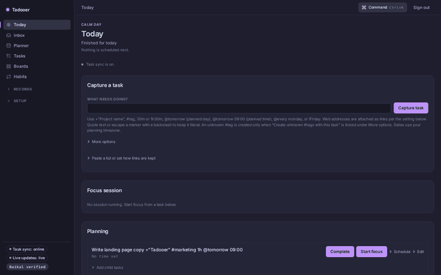 | 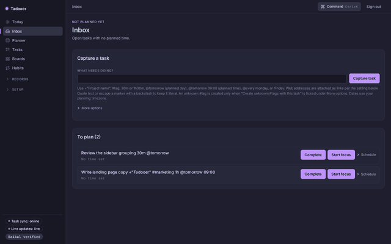 | 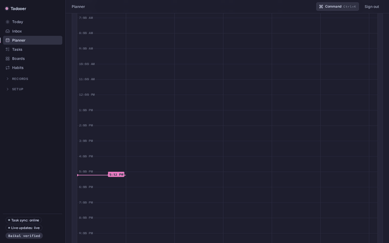 |

| Tasks                                   | Tasks › Organize                                    | Boards                                    |
| --------------------------------------- | --------------------------------------------------- | ----------------------------------------- |
| 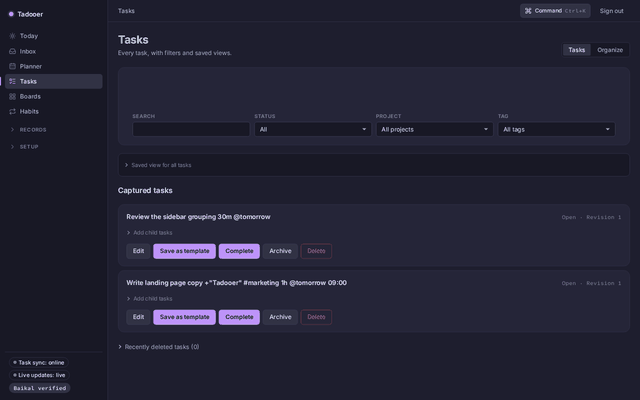 | 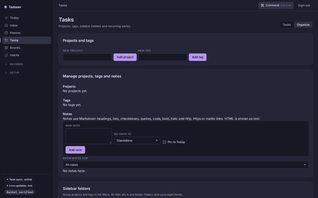 | 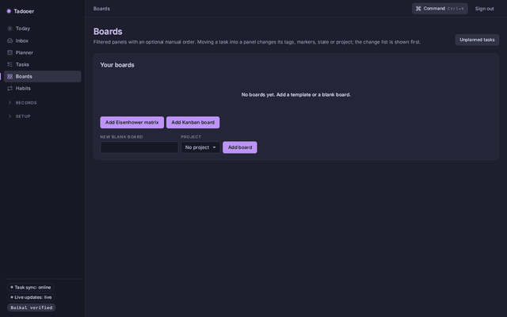 |

| History                                     | Worklog                                     | Counters                                      |
| ------------------------------------------- | ------------------------------------------- | --------------------------------------------- |
| 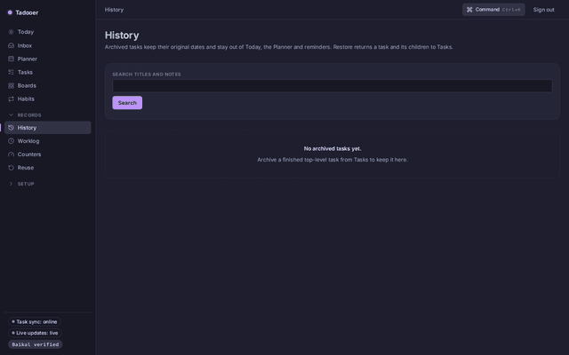 | 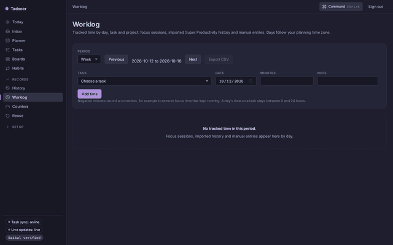 | 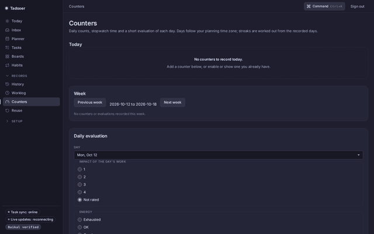 |

| Reuse                                   | Habits                                    | Connections                                         |
| --------------------------------------- | ----------------------------------------- | --------------------------------------------------- |
| 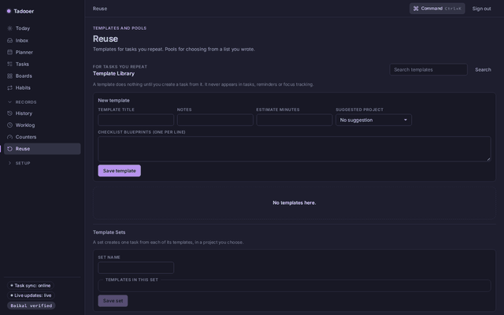 | 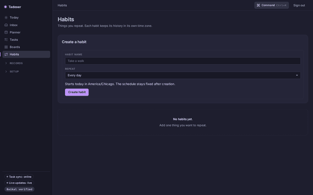 | 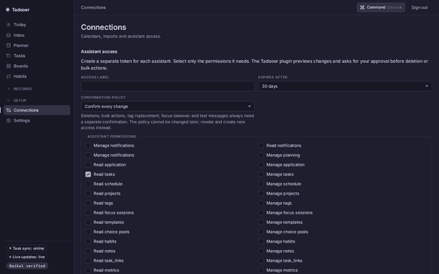 |

| Settings                                      |
| --------------------------------------------- |
| 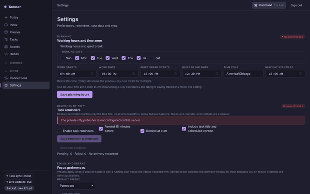 |

Phone, 390 px:

| Today                                 | Planner                                   | Tasks                                 | Boards                                  |
| ------------------------------------- | ----------------------------------------- | ------------------------------------- | --------------------------------------- |
| 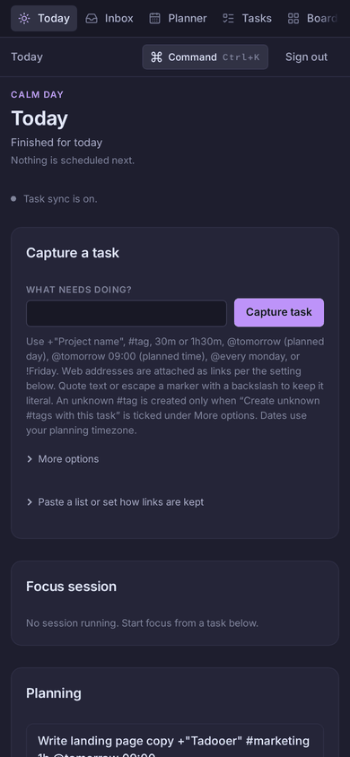 | 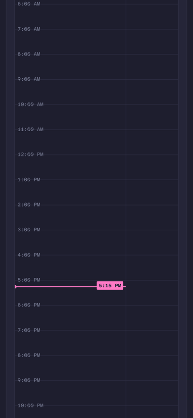 | 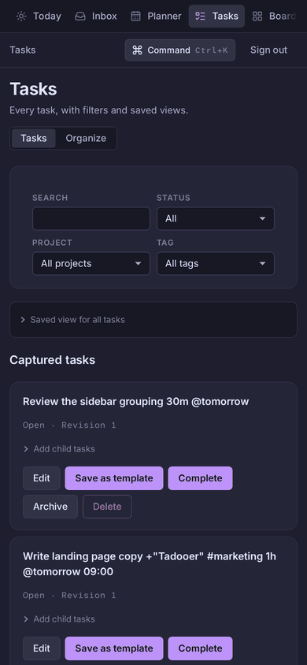 | 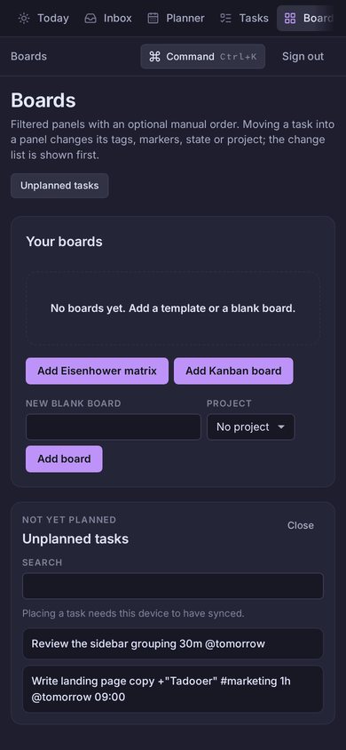 |

## Checks

- `pnpm --filter @suite/web typecheck`, ESLint on the changed files, and the
  web Vitest suite (70 files) passed on the source revision above.
- Static-markup tests cover the sidebar grouping (`SidebarNav.test.tsx`) and
  the omitted Today sections (`today-queue.test.tsx`).
- The phone-layout contract test still passes; the group toggles are hidden
  below 64 rem and the links keep their 2.75 rem tap height.
- Not done: a screen-reader pass of the new group toggles on a real device.
